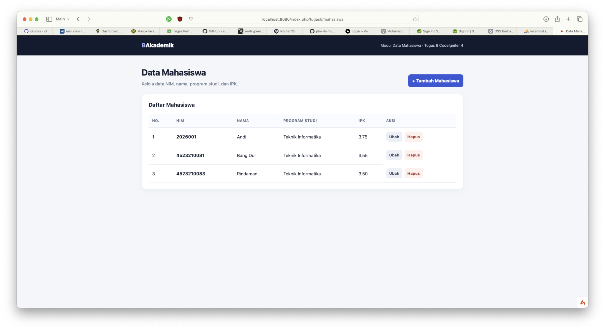
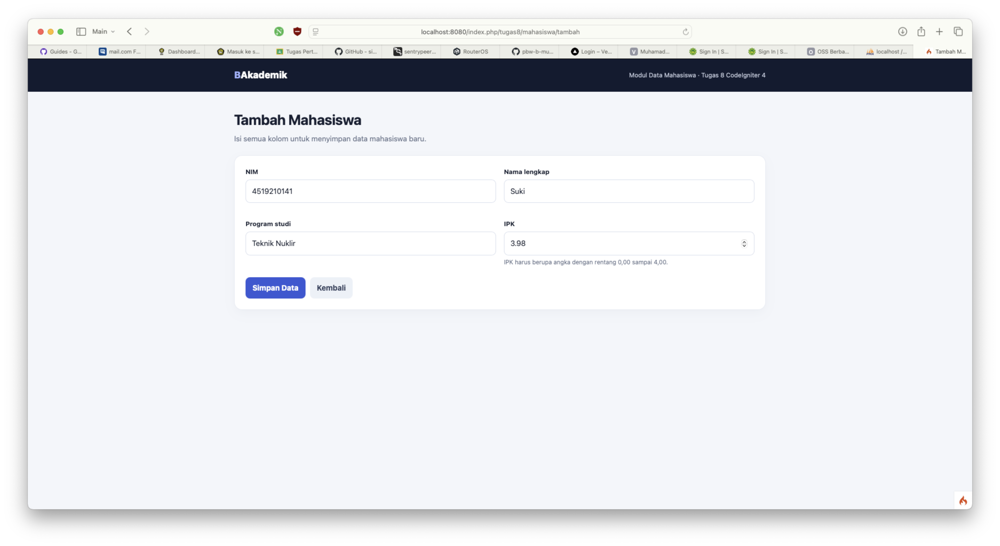
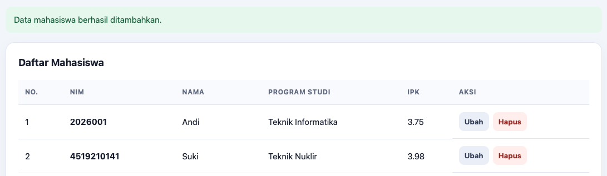
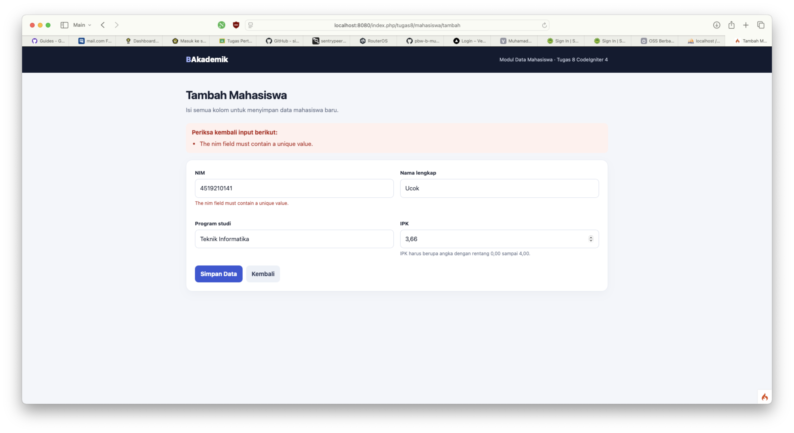
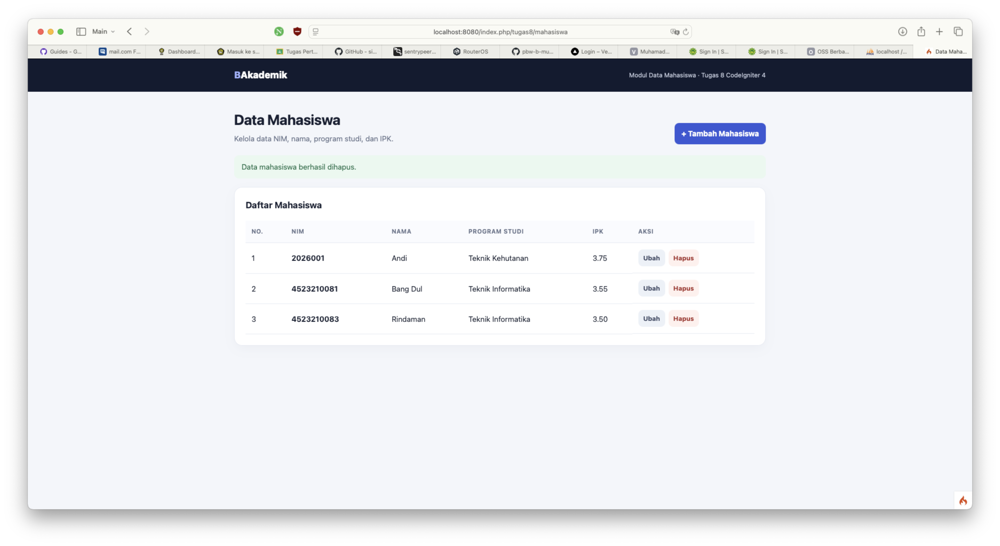

# Tugas 8 — Modul Data Mahasiswa dengan CodeIgniter 4

**Nama:** Muhamad Bachtiar  
**NIM:** 4524210141  
**Mata Kuliah:** Praktikum Pemrograman Berbasis Web B  
**Topik:** CRUD Data Mahasiswa dengan CodeIgniter 4

## 1. Deskripsi

Tugas ini merupakan project CodeIgniter 4 tersendiri yang dibuat di dalam folder `p8-akademik-ci4/tugas-8`. Aplikasi mengelola data mahasiswa dengan operasi Create, Read, Update, dan Delete (CRUD), serta validasi input menggunakan validation rules bawaan CodeIgniter 4.

Data mahasiswa terdiri dari:
- NIM
- Nama
- Program Studi (Prodi)
- IPK

## 2. Struktur Project

Folder `tugas-8` merupakan root project CodeIgniter 4. Setelah instalasi Composer dan pemasangan file tugas, struktur utamanya menjadi:

```text
tugas-8/
├── app/
│   ├── Config/
│   │   └── Routes.php
│   ├── Controllers/
│   │   └── Tugas8MahasiswaController.php
│   ├── Models/
│   │   └── Tugas8MahasiswaModel.php
│   └── Views/
│       └── tugas8/
│           └── mahasiswa/
│               ├── _header.php
│               ├── _footer.php
│               ├── _form.php
│               ├── index.php
│               ├── create.php
│               └── edit.php
├── public/
├── tests/
├── vendor/
├── writable/
├── spark
├── composer.json
├── composer.lock
├── env
├── .env
├── database.sql
├── routes-snippet.php
├── screenshots/
└── README.md
```

## 3. Application Features

1. **Read:** menampilkan daftar mahasiswa.
2. **Create:** menambahkan data mahasiswa.
3. **Update:** mengubah data mahasiswa.
4. **Delete:** menghapus data mahasiswa dengan konfirmasi.
5. **Validasi:** memeriksa kolom wajib, panjang teks, NIM unik, serta rentang IPK 0–4.
6. **Pesan kesalahan:** menampilkan kesalahan validasi pada halaman form dan mempertahankan input sebelumnya.
7. **Pesan status:** menampilkan notifikasi setelah data berhasil ditambah, diubah, atau dihapus.

## 4. Database Configuration

### `.env` Configuration

```ini
CI_ENVIRONMENT = development

database.default.hostname = localhost
database.default.database = akademik
database.default.username = root
database.default.password =
database.default.DBDriver = MySQLi
database.default.port = 3306
```

## 5. Application Routes

Route tugas ditambahkan pada `app/Config/Routes.php` milik project `tugas-8`, bukan pada `p8-akademik-ci4/app/Config/Routes.php`.

Route yang digunakan:

```php
$routes->get('tugas8/mahasiswa', 'Tugas8MahasiswaController::index');
$routes->get('tugas8/mahasiswa/tambah', 'Tugas8MahasiswaController::create');
$routes->post('tugas8/mahasiswa/simpan', 'Tugas8MahasiswaController::store');
$routes->get('tugas8/mahasiswa/ubah/(:num)', 'Tugas8MahasiswaController::edit/$1');
$routes->post('tugas8/mahasiswa/perbarui/(:num)', 'Tugas8MahasiswaController::update/$1');
$routes->post('tugas8/mahasiswa/hapus/(:num)', 'Tugas8MahasiswaController::delete/$1');
```

## 6. Aturan Validasi

| Kolom | Aturan |
|---|---|
| NIM | Wajib diisi, 5–20 karakter, dan harus unik |
| Nama | Wajib diisi, 3–100 karakter |
| Prodi | Wajib diisi, 3–100 karakter |
| IPK | Wajib berupa angka antara 0 dan 4 |

Validasi dilakukan pada Controller menggunakan `$this->validate()`. Jika validasi gagal, pengguna dikembalikan ke form. Pesan kesalahan ditampilkan pada View dan input sebelumnya tetap dipertahankan.

## 7. Pengujian

| No. | Pengujian | Hasil yang diharapkan |
|---|---|---|
| 1 | Membuka halaman daftar mahasiswa | Data mahasiswa ditampilkan |
| 2 | Menambahkan data valid | Data baru masuk ke daftar |
| 3 | Mengosongkan kolom wajib | Pesan kesalahan validasi tampil |
| 4 | Memasukkan NIM yang sudah digunakan | Pesan NIM harus unik tampil |
| 5 | Mengubah data mahasiswa | Data pada daftar diperbarui |
| 6 | Menghapus data mahasiswa | Data dihapus setelah konfirmasi |

## 9. Dokumentasi Screenshot

<p align="center">
  
</p>
<p align="center">
  
  
</p>
<p align="center">
  
</p>
<p align="center">
  
</p>
<p align="center">
  
</p>
