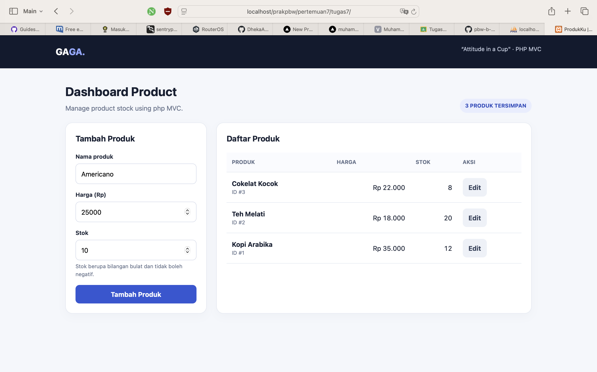
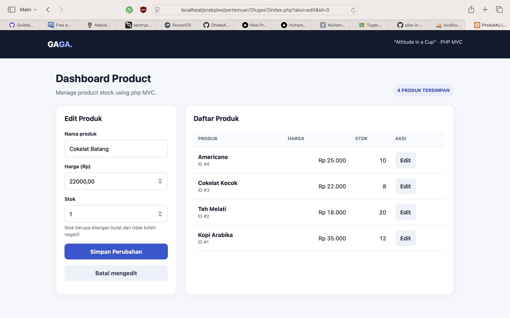
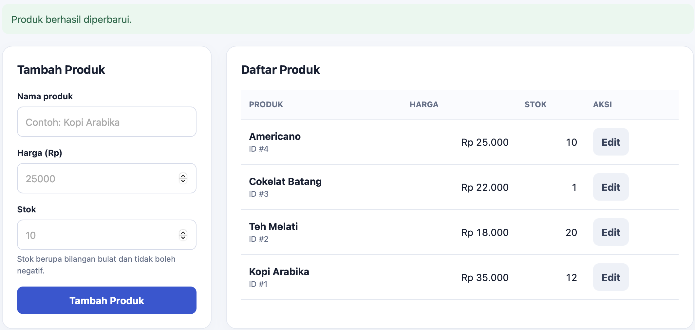
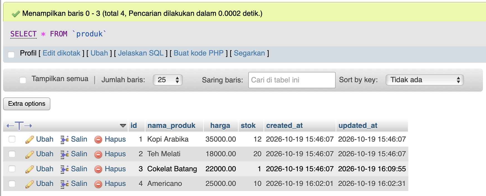

# Tugas 7 — Dashboard Penjualan Produk dengan MVC

**Mata kuliah:** Praktikum Pemrograman Berbasis Web B  
**Nama:** Muhamad Bachtiar  
**NIM:** 4524210141  
**Topik:** Model–View–Controller (MVC), PHP, MySQL

## Deskripsi
menampilkan, menambahkan, dan mengedit produk. Struktur Model, View, dan Controller dipisahkan agar fungsi kode lebih teratur.

## Struktur folder
```text
tugas7/
├── controllers/ProdukController.php
├── models/ProdukModel.php
├── screenshots/
├── views/produk/index.php
├── database.sql
├── index.php
├── koneksi.php
└── README.md
```

## Fungsi file
- `models/ProdukModel.php`: mengambil, menambah, dan mengubah data di database.
- `views/produk/index.php`: tampilan form dan tabel produk.
- `controllers/ProdukController.php`: mengatur alur permintaan, validasi, dan pemanggilan Model.
- `index.php`: landing page, memuat file dan menjalankan Controller.
- `koneksi.php`: koneksi PHP ke MySQL.

## Poin pengembangan
1. Tampilan responsif dengan form dan tabel produk.
2. Validasi nama wajib diisi, harga tidak negatif, dan stok bilangan bulat nonnegatif.
3. Prepared statement digunakan untuk operasi tambah, cari, dan edit.
4. Teks keluaran diamankan dengan `htmlspecialchars`.
5. Pesan status ditampilkan setelah proses.

## Pengujian dan screenshot
- Daftar produk: buka halaman utama dan pastikan tiga data contoh tampil.
- Tambah: isi nama, harga, dan stok, lalu klik **Tambah Produk**.
- Edit: klik **Edit**, ubah data, lalu klik **Simpan Perubahan**.
- Validasi: coba nama kosong atau harga/stok negatif.


## 7. Dokumentasi Screenshot Hasil Program

Berikut adalah dokumentasi hasil implementasi Penjualan Produk menggunakan konsep Model-View-Controller (MVC) dengan PHP dan MySQL.

### 7.1 Halaman Daftar & Form Tambah Produk

Halaman utama menampilkan daftar produk beserta harga, stok, dan tombol untuk mengedit data produk.

<p align="center">
  
</p>

### 7.2 Form Edit Produk

Form edit digunakan untuk mengubah informasi produk yang sudah tersimpan di database.

<p align="center">
  
</p>

### 7.3 Hasil Perubahan Data Produk

Setelah perubahan disimpan, web menampilkan pesan keberhasilan dan daftar produk yang sudah diperbarui.

<p align="center">
  
</p>

### 7.4 Daftar Produk dan Database

Data produk tersimpan di database MySQL melalui phpMyAdmin.

<p align="center">
  
</p>